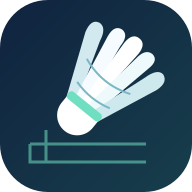

<p align="center">
  
</p>

<h1 align="center">NEU Court Booking</h1>

<p align="center">
  东北大学南湖羽毛球预约助手<br>
  <sub>中文桌面界面 · 单日预约 · 本人登录与付款</sub>
</p>

<p align="center">
  <a href="https://github.com/Oppie2333/neu-court-booking/releases/tag/v1.2.0-preview.2"></a>
  
  <a href="LICENSE"></a>
  
</p>

<p align="center">
  <a href="https://github.com/Oppie2333/neu-court-booking/releases/tag/v1.2.0-preview.2">下载运行包</a> ·
  <a href="docs/使用说明.md">使用说明</a> ·
  <a href="NEWS.md">NEWS</a> ·
  <a href="CHANGELOG.md">更新记录</a> ·
  <a href="https://github.com/Oppie2333/neu-court-booking/issues">问题反馈</a>
</p>

<p align="center">
  
</p>

面向拥有学校预约权限的同学，帮助完成**一次日期明确、最多一份订单**的南湖羽毛球预约。自己设置扫描时间、打球时段与可选场地，由本人登录学校，程序在指定窗口内查找并处理预约流程。

📍 **适用范围**：目前程序主要用于东北大学**南湖羽毛球馆**预约，开发和测试也以南湖馆为主。南湖馆仅有 **12 片场地**，热门时段较难预约；根据维护者近期体验，浑南暂不存在同样的场地紧张问题。本项目尚未针对浑南馆完成适配验证。

> **当前版本为 v1.2.0-preview.2 预发布测试版。** 103 项自动测试、本地 Chrome 模拟流程与运行包启动检查已通过；真实学校预约和支付全流程、真实高峰成功率及另一台电脑的兼容性尚未验证。不保证抢到场地。本项目由个人维护，非学校官方产品。

## 🚀 三步开始

| 步骤 | 操作 |
| :--- | :--- |
| **01 · 下载** | 在 [Releases](https://github.com/Oppie2333/neu-court-booking/releases/tag/v1.2.0-preview.2) 下载 `NEUCourtBooking-1.2.0-preview.2-windows-x64.zip`，完整解压后双击 `NEUCourtBooking.exe`。无需 Python，需已安装 **Google Chrome**；附件 `SHA256SUMS.txt` 提供校验值。 |
| **02 · 设置** | 填写预约日期、扫描开始与结束时间、打球时段、可选场地编号、查询间隔和同行人，点击“确认设置并开始”；在新打开的 Chrome 中自行登录学校。 |
| **03 · 等待** | 核对本次摘要并确认程序已就绪，保持电脑开机联网、不休眠。若打开付费二维码，核对金额后由本人完成付款。 |

首次启动浏览器会联网获取匹配驱动，请提前准备。**GitHub 的 Code → Download ZIP 是源码**，普通用户请选择 Release 附件中的 Windows 运行包；保留解压目录的全部文件。

📖 完整操作、停止方法及故障处理见 [使用说明](docs/使用说明.md)。

## 🏸 可以帮你做什么

| 能力 | 具体行为 |
| :--- | :--- |
| **自己确定时间** | 分别填写扫描时间窗口和打球时段。程序不预设学校放号时刻，不按周末切换规则；在你指定的范围内同等考虑免费、付费场次，不按价格优先排序。 |
| **指定多片备选场地** | 例如填写 `10,8,12`，只考虑这三片场地，按输入顺序优先；留空考虑任意场地。多片场地是备选，依次处理，最多生成一份订单。 |
| **调整查询间隔** | 使用一个固定间隔，可设 0.5–60 秒，推荐 `0.5` 秒。查询串行执行，上一轮未结束不会叠加请求；繁忙时自动退避。 |
| **确认学校弹窗** | 学校预约和收银页面的浏览器原生弹窗，无论文字内容都反复点“确认 / 确定”。关闭后再检查响应与订单；确认失败、请求已结束且仍为同一表单时，重试同一场次的“去支付”。 |
| **核对预约结果** | 免费场核验订单日期、场地、时段及有效状态；付费场核对金额并尝试点击学校“申请支付”打开可识别的付款二维码，再由本人付款。结果未知时先查已有订单。 |
| **保留操作控制** | 不自动开始，开始前确认本次摘要；自动勾选条款需登录后阅读并独立授权。支持停止任务，到扫描结束时停止新的提交。 |

例如，扫描 `12:25–12:45` 表示程序在预约日期当天的这段北京时间内查场；打球 `14:00–21:00` 表示只考虑不早于 14:00 开始、不晚于 21:00 结束的完整场次。两组时间均不跨午夜，结束需晚于开始，由你分别填写，示例不代表学校放号规则。学校可能按上午、下午或晚间场次分别放号，时间也可能调整，请先核对当前公告和预约页面。

免费与付费没有优先级，也没有先等免费再开放付费的倒计时。付费仍保留**每场最多 30 元**的内置保护，预计超出上限的场次不纳入候选，支付页金额异常或无法核验时暂停；生成任一场订单后停止继续扫描。多个编号不会启动多个并发程序。

推荐查询间隔 `0.5` 秒对应最多每秒 2 次，这是相邻两轮开始查询的最小间隔，实际频率取决于学校响应速度。网站繁忙时退避 2 / 4 / 8 秒，个人设置更慢时采用较慢值。修改间隔不改变异常弹窗确认、提交重试或支付流程。

登录、验证码和最终付款由本人完成。**待支付不代表预约成功**，最终以学校有效订单为准。运行期间不要同时手工提交同一任务。

自动确认弹窗不代表自动支付钱包款项，也不代替登录后对学校条款的本次授权。弹窗提示“已有预约”时同样会先关闭，再核验已有订单；提交结果不明时先查单，避免重复预约。

## 📰 NEWS

**2026-10-24 · v1.2.0-preview.2 预发布测试版** — 自选扫描窗口、打球窗口与场地备选，单一查询间隔；学校原生弹窗反复确认，关闭后核验订单与响应。103 项测试及本地 Chrome 模拟通过。

**2026-10-23 · v1.1.0** — 三种预约模式、自定义查询间隔和更清楚的时段说明，配套像素 Q 版项目美术；以预发布测试版提供。

**2026-10-19 · v1.0.0** — 首个可分发测试版：中文设置界面、异常提示重试、订单核验、Windows 运行包与开源构建流程。

查看 [最新动态](NEWS.md) · [完整更新记录](CHANGELOG.md) · [发布说明模板](.github/RELEASE_TEMPLATE.md)

## 🛠️ 从源码运行

需要 Windows、Chrome 和 **Python 3.11+**（建议 3.12 x64）。双击 `启动源码版.cmd`，或在项目目录执行：

```powershell
python -m pip install -r requirements.txt
python main.py
```

<details>
<summary>开发检查与 Windows 构建</summary>

```powershell
python -m pip install -r requirements-dev.txt
python -m unittest discover -s tests
powershell -ExecutionPolicy Bypass -File scripts/build.ps1
```

构建输出为 `dist/NEUCourtBooking`，分发时压缩整个目录。本版 103 项自动测试通过，本地 Chrome 模拟覆盖连续弹窗确认、明确失败后重试、结果未知时核验与付款二维码交接；运行包已通过界面和 Chrome `about:blank` 启动检查。上述检查不代表真实高峰预约成功率，尚未在另一台干净电脑验证。

版本使用 `主版本.次版本.修订号`；程序版本见 `app_settings.py`，发布版本同步记录在 [VERSION](VERSION) 与 [CHANGELOG](CHANGELOG.md)。提交先记录在 `Unreleased`，发布时建立 `v版本号` 标签。详见 [发布到 GitHub](docs/发布到GitHub.md)。

</details>

## 🔒 数据与反馈

本机数据位于 `%LOCALAPPDATA%\NEUCourtBooking`，包括同行人设置、任务状态及诊断资料。分享软件时转发原始运行包即可；不要公开个人数据目录、密码、cookie、订单信息或支付码。反馈请使用 [Issue 模板](https://github.com/Oppie2333/neu-court-booking/issues/new?template=bug_report.md)，并先遮盖私人内容。

欢迎提交可复现的问题和改进。适配新场馆或修改学校流程时，请说明依据，并补充相应验证。

## 🤝 许可与致谢

程序与项目美术采用 [MIT License](LICENSE)，像素 Q 版页首插画由 AI 辅助生成，来源与设计说明见 [素材说明](docs/assets/ATTRIBUTION.md)。第三方运行组件保留各自许可，见 [THIRD_PARTY_NOTICES](THIRD_PARTY_NOTICES.md)。

开发时审阅过 [Jian2032/neu_badminton_tool](https://github.com/Jian2032/neu_badminton_tool) 与 [MeowgicalAI/Auto-Reservation](https://github.com/MeowgicalAI/Auto-Reservation)，并根据学校实际页面独立实现本项目。参考仓库的完整授权未核实，本项目不分发其代码、驱动或可执行程序。
