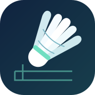
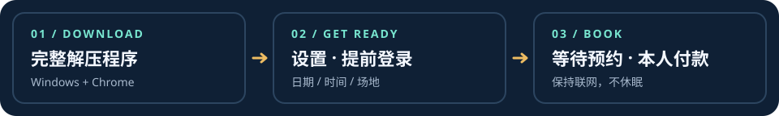

  

<h1 align="center">NEU Court Booking</h1>

🏸 东北大学南湖羽毛球预约助手

  
  
  
  

  <a href="https://github.com/Oppie2333/neu-court-booking/releases/download/v1.2.0-preview.3/NEUCourtBooking-1.2.0-preview.3-windows-x64.zip">📦 下载 Windows 版</a> ·
  <a href="docs/使用说明.md">📖 使用说明</a> ·
  <a href="NEWS.md">📰 NEWS</a> ·
  <a href="https://github.com/Oppie2333/neu-court-booking/issues">💬 问题反馈</a>

  

自己选择扫描时间、打球时段与场地，程序在指定范围内查场、处理预约流程。

> ✅ 根据使用者反馈，程序已在本机和其他电脑**多次成功预约，实测有效**。不保证 100% 抢到；建议**尽早启动、提前登录学校预约系统并确认任务已就绪**。最终以学校有效订单为准。

## 🚀 三步开始

  

1. **📦 下载解压**：下载上方 Windows 版，完整解压后打开 `NEUCourtBooking.exe`。需安装 **Chrome**，无需 Python。
2. **⚙️ 填写需求**：设置预约日期、扫描起止时间、打球时段和同行人。场地填 `10,8,12` 按顺序优先，留空考虑全部场地。
3. **🔑 提前就绪**：点击“确认设置并开始”，本人登录学校，按提示阅读条款并授权，确认任务就绪后保持电脑开机联网、不休眠；出现支付码后核对金额并本人付款。

💡 首次启动浏览器需联网获取驱动，请提前准备。**Code → Download ZIP 是源码**；普通用户请下载 [Release](https://github.com/Oppie2333/neu-court-booking/releases/tag/v1.2.0-preview.3) 的 Windows 附件，校验值见 `SHA256SUMS.txt`。

## ✨ 功能一览

| ⏱️ 自定时间 | 🎯 多片备选 | 🔄 自动继续 | 💳 本人付款 |
| :---: | :---: | :---: | :---: |
| 扫描和打球时段分别设置 | 按填写顺序优先，留空选全部 | 网络/繁忙弹窗确认，明确约满后换场 | 打开付款二维码，由你核对并支付 |

🆕 **v1.2.0-preview.3**：约满后保留登录继续扫描，刚约满的具体场次暂时跳过 30 秒，减少重复选择。112 项测试及浏览器模拟通过；本次修复的真实高峰效果待继续反馈。[更新记录 →](CHANGELOG.md)

🔎 不写死放号规则，不区分免费/付费优先；查询间隔可调，推荐 **0.5 秒**，串行执行、繁忙退避。每次任务最多一份订单，付费每场最多 **30 元**。**待支付不等于预约成功**；提交结果不明时先查单。

📍 主要针对**东北大学南湖羽毛球馆（12 片场地）**开发测试；根据使用体验，浑南暂未遇到同样的场地紧张问题，尚未完成浑南适配。个人开源项目，非学校官方产品。

🔒 分享原始运行包即可，请勿公开本机个人数据、学号、cookie、订单或支付码。详细设置与排障见 [使用说明](docs/使用说明.md)。

  <a href="docs/开发说明.md">🛠️ 源码与构建</a> ·
  <a href="docs/发布到GitHub.md">🚢 发布指南</a> ·
  <a href="docs/assets/ATTRIBUTION.md">🎨 美术说明</a> ·
  <a href="THIRD_PARTY_NOTICES.md">🤝 第三方许可</a> ·
  <a href="LICENSE">MIT</a>

